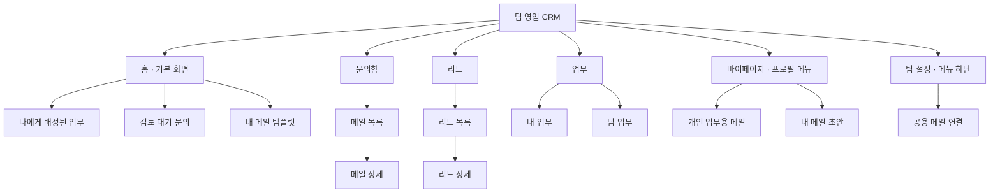

# 팀 영업 CRM 사이트 정보 구조

**목업 제안** · 로그인하면 **홈**에서 내게 배정된 업무를 바로 확인한다. 왼쪽 메뉴에는 **홈 · 문의함 · 리드 · 업무**를 두고, 프로필 메뉴에서 **마이페이지**를 연다. 하단 **팀 설정**에서 공용 메일 연결을 관리한다. 공용 메일은 첫 버전부터 자동으로 수집한다.

## 사이트 지도

## 화면별로 찾을 수 있는 정보

| 메뉴 | 화면에 표시할 정보 | 여기서 하는 일 |
| --- | --- | --- |
| **홈** | 내 업무의 기한과 검토 대기 문의를 요약한다. 왼쪽에 기한순 미완료 업무를, 오른쪽에 검토할 문의와 내 메일 템플릿을 배치한다. | 문의를 검토하거나 내 업무를 연다. 오른쪽에서 템플릿을 만들거나 펼쳐서 편집한다. |
| **문의함** | 동기화 상태, 검색·필터, 검토 대기·리드 연결됨·처리 제외 메일을 표시한다. 사이드바 숫자는 검토 대기 건수다. | 메일을 검토해 새 리드를 등록한다. 등록된 문의에서는 해당 리드를 연다. |
| **리드** | 고객사별 영업 단계, 책임자, 다음 업무, 최근 접촉을 표시한다. 상세 탭은 **개요 · 업무 · 활동**이다. | 리드명 옆에서 리드를 수정한다. 개요의 다음 업무와 최근 접촉에서 각각 업무 추가와 활동 기록을 시작한다. 고객 연락처와 도입 관련 정보는 고객 정보에서 편집한다. |
| **업무** | **내 업무 · 팀 업무** 탭과 담당자·상태 필터 | 배정된 업무의 상태를 변경하고, 맥락이 필요할 때 관련 리드로 이동한다. |
| **마이페이지** | 내 프로필, 개인 업무용 메일 주소, 내 메일 초안 | 발신 주소를 등록하고 메일 초안을 만들거나 편집한다. |
| **팀 설정** | 공용 메일 연결 상태와 마지막 성공 시각 | 연결 권한자가 메일함을 연결·재연결·해제한다. 문의함의 수집 장애 안내에서도 연결 설정으로 이동한다. |

## 화면 간 이동

1. **문의 접수** — 공용 메일 자동 수집 → 문의함의 검토 대기 → 메일 상세 → 새 리드 등록 → 리드 상세.
2. **후속 처리** — 리드 상세의 업무 탭에서 담당자 배정 → 담당자의 홈 또는 내 업무 → 관련 리드 상세에서 통화 기록과 영업 단계 확인.
3. **문의 원문 확인** — 문의함의 ‘리드 연결됨’ 필터 → 메일 상세. 연결된 리드는 상세에서 ‘리드 보기’로 연다.

영업 단계별 진행 상황은 리드 목록의 단계 필터에서 확인한다. 리드 책임자는 딜 전체를 보고, 각 후속 업무는 다른 팀원이 맡을 수 있다.

## 템플릿으로 메일 초안 만들기

1. 마이페이지에서 개인 업무용 메일 주소를 등록하고, 홈에서 ‘첫 회신’, ‘미팅 일정 제안’, ‘제안서 전달’ 같은 제목·본문 템플릿을 저장한다.
2. 마이페이지에서 ‘메일 초안 만들기’를 누르고 관련 리드를 고른다. 리드의 연락처와 연결된 메일의 발신자를 수신자 후보로 표시한다.
3. 템플릿을 선택하면 확인된 고객사명, 담당자명, 내 이름을 해당 자리에 채운다. 값이 비어 있으면 ‘입력 필요’로 표시한다. 수신자, 제목, 본문을 검토하고 편집한 뒤 초안을 저장한다.
4. 저장한 초안은 선택한 리드와 연결되며, 작성자는 마이페이지의 ‘내 메일 초안’에서 다시 연다.

## 목업에서 검증할 가정

- 로그인 후 홈에서 내 미완료 업무를 보여주고, 업무 메뉴에서는 내 업무를 먼저 연다.
- 자동 수집된 메일을 팀원이 검토해 새 리드로 등록한다.
- 영업 현황은 리드 목록에서 확인하고, 통화·미팅 이력은 리드 상세에서 조회한다. 실제 팀 역할과 영업 단계명은 목업에서 예시로 표시한다.
- 개인 업무용 메일은 목업에서 주소를 등록하고 CRM 안에 편집 가능한 초안을 저장하는 흐름으로 검증한다. 개인 메일 계정 인증, 메일 서비스 초안 동기화, CRM 내 실제 발송은 추후 결정한다.
